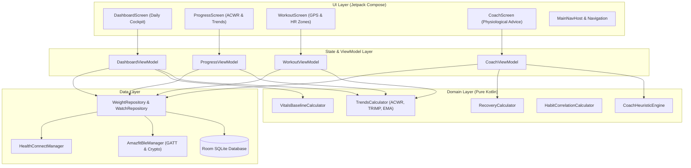
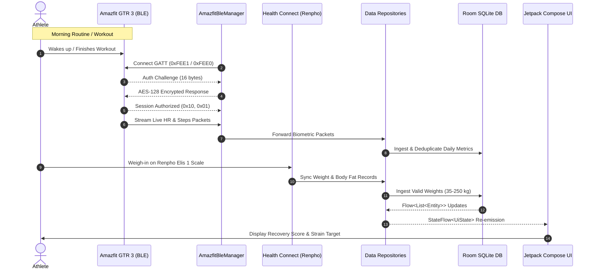

# System Architecture

[English](ARCHITECTURE.md) | [Español](../es/ARCHITECTURE.md)

This document provides a comprehensive technical overview of **Homeo**'s software architecture, component layers, data flows, and state management patterns.

---

## Architectural Principles

Homeo follows **Clean Architecture** combined with the **Model-View-Intent (MVI)** state pattern on Android:

1. **Unidirectional Data Flow (UDF):** UI components observe immutable state flows (`StateFlow<UiState>`) and dispatch user intents/events to ViewModels. ViewModels orchestrate domain business logic and update state atomically.
2. **Deterministic & Framework-Free Domain:** All athletic calculations, load models, and biometric baselines exist as pure Kotlin objects without references to Android framework classes (`android.*`), enabling instantaneous unit testing.
3. **Repository Abstraction:** The domain layer accesses health data through interfaces, completely decoupling business rules from whether data originates from local Room SQLite, direct Bluetooth LE characteristics, or Android Health Connect.
4. **Offline-First Storage:** Local Room SQLite acts as the single source of truth. External device inputs are ingested, sanitized, and stored locally before being presented to the user.

---

## High-Level System Architecture

---

## Layer Breakdown

### 1. Presentation / UI Layer (`com.salud.personal.ui.*`)

- **Jetpack Compose & Material 3:** Built entirely with declarative Compose components. No legacy XML view bindings or fragment lifecycles.
- **OLED Design System (`WhoopColors`):** High-contrast dark theme centered on true pitch black (`#0A0B0D`) and high-impact semantic accents:
  - `Strain`: Cyan/Electric Blue (`#00E5FF` / `#2979FF`)
  - `Recovery`: Emerald/Acid Green (`#00E676`)
  - `Warning / Overload`: Amber/Red (`#FFA726` / `#FF5252`)
  - `Weight`: Purple/Indigo (`#B388FF`)
- **EasyUI Primitives (`ui/easyui`):** Reusable high-performance UI primitives like `EasySpotlightCard` (dynamic radial hover lights) and `tactilePress` (spring-based touch physics).

### 2. State & ViewModel Layer

- ViewModels expose read-only `StateFlow<UiState>` instances initialized via `stateIn(viewModelScope, SharingStarted.Eagerly, ...)`.
- Reactive multi-flow combination: ViewModels combine multiple Room Dao flows and user preference state flows (`combine(...)`) into cohesive screen state objects with zero unnecessary UI re-renders.

### 3. Domain Layer (`com.salud.personal.domain.*`)

Contains all sports physiology models and business algorithms:

- **`TrendsCalculator`:**
  - `calculateAcwr(acuteLoad7d, chronicLoad28d)`: Computes Gabbett's ratio and categorizes risk into `UNDER_TRAINING`, `OPTIMAL_SWEETSPOT`, `HIGH_RISK`, or `VERY_HIGH_RISK`.
  - `calculateTrimp(durationMinutes, avgHr, maxHr, restingHr, isMale)`: Banister's exponential workload formula.
  - `calculateExponentialTrendWeight(points, alpha = 0.10)`: MacroFactor-inspired exponential moving average to filter daily water weight noise.
  - `calculateRhrTrend(points)`: Calculates 30-day trimmed baseline and standard deviations for resting heart rate.
  - `calculateWeeklyComparison(...)`: Computes period-over-period deltas for TRIMP, steps, sleep, and heart rate across 7D, 30D, and 90D windows.
- **`RecoveryCalculator`:** Weighted composite index evaluating resting heart rate vs. baseline, sleep duration, and subjective check-in.
- **`CoachHeuristicEngine`:** Deterministic recommendation generator providing training strain targets, active recovery suggestions, and bedtime advice.
- **`VitalsBaselineCalculator`:** Evaluates daily metrics against individual physiological tolerance ranges.

### 4. Data Layer (`com.salud.personal.data.*`)

#### Room Local Database (`data/local`)
- **`AppDatabase`:** Room SQLite database instance managing entities:
  - `WeightMeasurementEntity`: Timestamped weight, body fat, impedance, provenance.
  - `WorkoutSessionEntity`: Activity type, start/end timestamps, duration, average/max HR, TRIMP, RPE, GPS path.
  - `DailyCheckInEntity`: Date, subjective readiness, resting heart rate, sleep rating, journal tags.
  - `DailyActivityEntity`: Daily steps, distance, active calories.
  - `SleepSessionEntity`: Sleep date, duration, stage distribution (deep, light, REM, awake).

#### Bluetooth Low Energy Driver (`data/ble`)
- **`AmazfitBleManager`:** Implements BluetoothGATT callbacks to communicate with Zepp OS smartwatches.
- **`HuamiCrypto`:** Handles authentication on UUID `0xFEE1`:
  1. Requests random 16-byte challenge from the watch (`0x02, 0x00`).
  2. Generates ephemeral ECDH keys on NIST Curve B-163.
  3. Computes AES-128 response using the secret Auth Key from `secrets.properties`.
  4. Sends encrypted response (`0x03, 0x00, [encrypted_bytes]`) to establish authorized session.
- **`HuamiMetricsParser`:** Streams real-time heart rate and step telemetry packets from UUID `0xFEE0`.

#### Android Health Connect Integration (`data/healthconnect`)
- **`HealthConnectManager`:** Interfaces with `androidx.health.connect:connect-client`.
- Ingests `WeightRecord` and `BodyFatRecord` inserted by third-party companion apps (e.g., Renpho Health) and maps them into Room entities with automatic 3-minute deduplication windows.

---

## Data Synchronization Sequence

