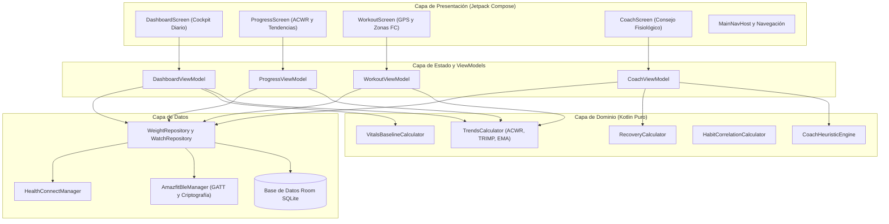
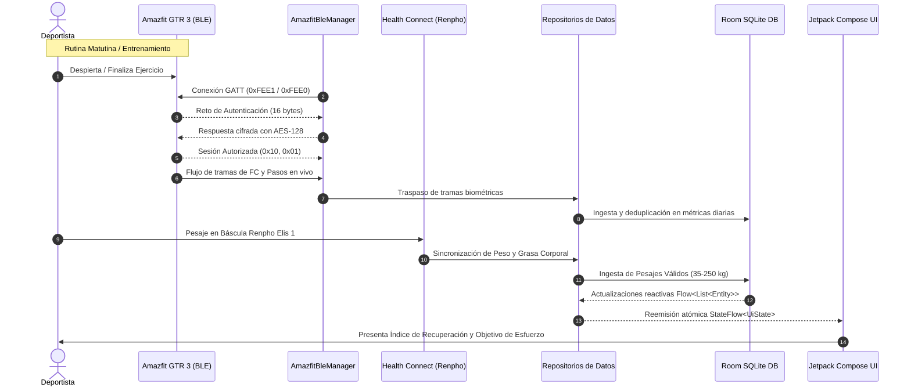

# Arquitectura del Sistema

[English](../en/ARCHITECTURE.md) | [Español](ARCHITECTURE.md)

Este documento proporciona una visión técnica exhaustiva de la arquitectura de software de **Homeo**, sus capas de componentes, flujos de datos y patrones de gestión de estado.

---

## Principios Arquitectónicos

Homeo implementa los principios de **Clean Architecture** junto al patrón de estado **Model-View-Intent (MVI)** en Android:

1. **Flujo Unidireccional de Datos (UDF):** Los componentes de UI observan flujos de estado inmutables (`StateFlow<UiState>`) y despachan intenciones/eventos de usuario hacia los ViewModels. Los ViewModels coordinan la lógica de negocio del dominio y actualizan el estado de forma atómica.
2. **Dominio Determinista y Aislado del Framework:** Todos los cálculos atléticos, modelos de carga y líneas base biométricas residen como clases puras de Kotlin sin referencias al framework de Android (`android.*`), lo que permite una ejecución inmediata y fiable de pruebas unitarias.
3. **Abstracción mediante Repositorios:** La capa de dominio accede a los datos de salud mediante interfaces, desacoplando completamente las reglas de negocio de si los datos proceden de Room SQLite local, de características Bluetooth LE directas o de Android Health Connect.
4. **Almacenamiento Local Prioritario (Offline-First):** La base de datos local Room SQLite constituye la única fuente de verdad (*single source of truth*). Las entradas de dispositivos externos se reciben, sanean y persisten localmente antes de presentarse al usuario.

---

## Arquitectura de Alto Nivel

---

## Desglose por Capas

### 1. Capa de Presentación / UI (`com.salud.personal.ui.*`)

- **Jetpack Compose y Material 3:** Construida íntegramente mediante componentes declarativos Compose. Sin bindings XML heredados ni ciclos de vida basados en Fragments.
- **Sistema de Diseño OLED (`WhoopColors`):** Tema oscuro de alto contraste basado en negro puro (`#0A0B0D`) y acentos semánticos de gran visibilidad:
  - `Strain` (Esfuerzo): Cian / Azul eléctrico (`#00E5FF` / `#2979FF`)
  - `Recovery` (Recuperación): Verde esmeralda neón (`#00E676`)
  - `Warning / Overload` (Precaución / Sobrecarga): Ámbar / Rojo (`#FFA726` / `#FF5252`)
  - `Weight` (Peso): Púrpura / Índigo (`#B388FF`)
- **Primitivas EasyUI (`ui/easyui`):** Componentes visuales de alto rendimiento como `EasySpotlightCard` (iluminación radial dinámica al enfocar) y `tactilePress` (animaciones táctiles basadas en física de muelles).

### 2. Capa de Estado y ViewModels

- Los ViewModels exponen instancias inmutables de `StateFlow<UiState>` inicializadas mediante `stateIn(viewModelScope, SharingStarted.Eagerly, ...)`.
- Combinación reactiva multiflujo: Los ViewModels integran múltiples flujos de Room DAOs y flujos de selección de usuario (`combine(...)`) en estados coherentes de pantalla sin provocar redibujados innecesarios en Compose.

### 3. Capa de Dominio (`com.salud.personal.domain.*`)

Contiene todos los modelos de fisiología deportiva y algoritmos de negocio:

- **`TrendsCalculator`:**
  - `calculateAcwr(acuteLoad7d, chronicLoad28d)`: Calcula el ratio de Gabbett y categoriza el riesgo en `UNDER_TRAINING`, `OPTIMAL_SWEETSPOT`, `HIGH_RISK` o `VERY_HIGH_RISK`.
  - `calculateTrimp(durationMinutes, avgHr, maxHr, restingHr, isMale)`: Fórmula de impulso exponencial de Banister.
  - `calculateExponentialTrendWeight(points, alpha = 0.10)`: Media móvil exponencial inspirada en MacroFactor para filtrar el ruido diario de retención de agua.
  - `calculateRhrTrend(points)`: Calcula la media recortada y desviaciones típicas a 30 días para la frecuencia cardíaca en reposo.
  - `calculateWeeklyComparison(...)`: Computa las diferencias periodo sobre periodo para TRIMP, pasos, sueño y pulso en ventanas de 7D, 30D y 90D.
- **`RecoveryCalculator`:** Índice ponderado compuesto que evalúa pulso en reposo frente a la línea base, duración de sueño y valoración subjetiva.
- **`CoachHeuristicEngine`:** Motor de recomendaciones deterministas que calcula objetivos de carga, descansos activos y pautas de descanso nocturno.
- **`VitalsBaselineCalculator`:** Evalúa métricas diarias respecto a rangos de tolerancia fisiológica individuales.

### 4. Capa de Datos (`com.salud.personal.data.*`)

#### Base de Datos Local Room (`data/local`)
- **`AppDatabase`:** Instancia de Room SQLite que gestiona las entidades:
  - `WeightMeasurementEntity`: Peso temporal, grasa corporal, impedancia y procedencia.
  - `WorkoutSessionEntity`: Tipo de ejercicio, marcas temporales, duración, FC media/máxima, TRIMP, RPE y ruta GPS.
  - `DailyCheckInEntity`: Fecha, disposición subjetiva, pulso en reposo, valoración de sueño y etiquetas del diario.
  - `DailyActivityEntity`: Pasos diarios, distancia y calorías activas.
  - `SleepSessionEntity`: Fecha de descanso, duración y desglose por fases (profundo, ligero, REM, vigilia).

#### Controlador Bluetooth Low Energy (`data/ble`)
- **`AmazfitBleManager`:** Implementa los callbacks de BluetoothGATT para dialogar con smartwatches Zepp OS.
- **`HuamiCrypto`:** Gestiona el protocolo de autenticación en el UUID `0xFEE1`:
  1. Solicita el reto aleatorio de 16 bytes al reloj (`0x02, 0x00`).
  2. Genera claves efímeras ECDH sobre la curva NIST B-163.
  3. Computa la respuesta AES-128 con la clave Auth Key privada de `secrets.properties`.
  4. Envía la respuesta cifrada (`0x03, 0x00, [bytes_cifrados]`) para validar la sesión autorizada.
- **`HuamiMetricsParser`:** Decodifica las tramas de telemetría de pasos y pulso en tiempo real emitidas desde el UUID `0xFEE0`.

#### Integración con Android Health Connect (`data/healthconnect`)
- **`HealthConnectManager`:** Conecta con `androidx.health.connect:connect-client`.
- Extrae registros `WeightRecord` y `BodyFatRecord` generados por aplicaciones compañeras (como Renpho Health) y los traslada a entidades de Room con deduplicación automática en ventanas de 3 minutos.

---

## Secuencia de Sincronización de Datos

