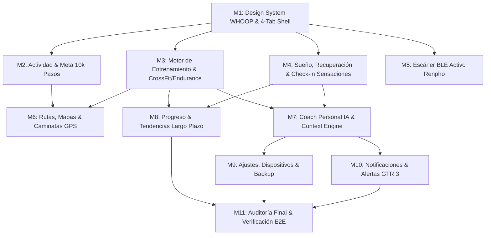

# Plan Maestro de Ejecución: Aplicación Personal de Salud, Rendimiento y Coach IA

> **Inspiración:** Experiencia visual, rigor y sobriedad de **WHOOP**.  
> **Dispositivos:** Amazfit GTR 3 (Zepp OS BLE) + Báscula Renpho Elis 1 (QN-Scale BLE).  
> **Stack:** Android Nativo (Kotlin 2.0, Jetpack Compose Material 3, Corrutinas/Flows, Room SQLite v2+, osmdroid/GPS, Google Gemini API con fallback heurístico local).  
> **Filosofía AGENTS.md:** Regla 1 estricta (cero eslóganes, cero texto de relleno motivacional, unidades honestas y legibles), privacidad absoluta y funcionamiento 100% local.

---

## Estado Actual del Repositorio (Línea Base)
- [x] Scaffolding Gradle 8.11.1, Kotlin 2.0.21, Jetpack Compose BOM 2024.10.00, Room 2.6.1.
- [x] Modelo de dominio y decodificador BLE de Renpho Elis 1 (`QnScalePacketParser`).
- [x] Pila BLE completa de Amazfit GTR 3 (ECDH NIST B-163, handshake Huami 2021, códec de chunks 0x03 con AES-128 y CRC32).
- [x] Persistencia Room con deduplicación idempotente (`WeightRepository`, `WatchRepository`, `HeartRateDao`, `DailyActivityDao`).
- [x] 107 pruebas unitarias pasando. Verificación en hardware físico (Google Pixel 7a).

---

## Fases y Desglose de Tareas de Ejecución

---

### Hito 1: Sistema de Diseño WHOOP y Shell de 4 Pestañas
**Objetivo:** Establecer la estética visual deportiva premium oscura inspirada en WHOOP, la paleta de colores de alto contraste, los componentes de anillo/arco de progreso y la barra de navegación inferior de 4 áreas (`Hoy`, `Entrenamiento`, `Progreso`, `Coach`).

- [ ] **Tarea 1.1: Paleta de Colores y Tipografía WHOOP (`ui/theme/`)**
  - Colores: Fondo profundo (`#0A0B0D`), Superficie (`#131519`), Superficie elevada (`#1C1F26`), Acento Esfuerzo/Strain (`#00E5FF` Cyan deportivo), Acento Recuperación (`#00E676` Verde esmeralda, `#FFB300` Ámbar, `#FF5252` Rojo), Acento Sueño (`#7C4DFF` Lavanda).
  - Tipografía tabular y monoespaciada para métricas numéricas grandes.
  - Criterio de aceptación: ThemeCompose configurado con tokens oscuros de alto contraste legibles bajo luz solar.
- [ ] **Tarea 1.2: Componentes de Visualización Biométrica (`ui/components/`)**
  - `WhoopProgressRing`: Anillo de progreso circular personalizable con trazo degradado, grosor ajustable y valor numérico central.
  - `BiometricMetricCard`: Tarjeta compacta de alto contraste con jerarquía estricta (etiqueta superior técnica en mayúsculas, valor gigante, unidad al lado, badge de variación).
  - Criterio de aceptación: Previews de Compose renderizando anillos de esfuerzo y recuperación sin texto superfluo.
- [ ] **Tarea 1.3: Navegación Principal de 4 Pestañas (`ui/navigation/`)**
  - Implementar `BottomNavBar` con iconos vectoriales sobrios para: `Hoy`, `Entrenamiento`, `Progreso`, `Coach`.
  - Transiciones fluidas entre pantallas manteniendo el estado (`rememberSaveable`).
  - Criterio de aceptación: Navegación interactiva entre las 4 áreas sin reinicio de estado ni flickering.
- **Commit Git:** `feat(ui): implement WHOOP-inspired dark design system and 4-tab navigation shell`

---

### Hito 2: Actividad Diaria y Meta de 10.000 Pasos
**Objetivo:** Convertir el contador de pasos en un objetivo interactivo de alto impacto visual con desglose horario, pasos restantes, ritmo de caminata y detección de sedentarismo.

- [ ] **Tarea 2.1: Modelo y Algoritmo de Actividad (`domain/activity/`)**
  - Cálculo de pasos restantes para la meta (configurable, por defecto 10.000).
  - Estimación de tiempo de caminata necesario para completar los pasos restantes según ritmo promedio.
  - Pruebas TDD para cálculo de porcentajes, límites y ritmo.
- [ ] **Tarea 2.2: Desglose Horario y Persistencia de Pasos (`data/local/`)**
  - Tabla `hourly_steps` con registro de pasos por intervalo de 1 hora para visualización de histograma del día.
  - DAO con inserción idempotente y consultas por fecha.
- [ ] **Tarea 2.3: Pantalla Detalle de Actividad Diaria (`ui/activity/`)**
  - Anillo principal de 10.000 pasos con porcentaje y pasos restantes en grande.
  - Histograma de barras horario (mañana, tarde, noche).
  - Histórico de 7 y 30 días con tasa de cumplimiento sin penalización excesiva en descansos.
- **Commit Git:** `feat(activity): add 10k steps ring, hourly breakdown, and activity details`

---

### Hito 3: Motor de Entrenamiento, CrossFit (WODs) y Endurance
**Objetivo:** Cuantificar el esfuerzo y efectividad real de los entrenamientos (CrossFit, running, remo, ciclismo, caminatas) separando Estímulo, Progreso y Coste de Recuperación.

- [ ] **Tarea 3.1: Algoritmo de Carga de Entrenamiento TRIMP y Zonas Cardíacas (`domain/training/`)**
  - Implementación de Banister TRIMP (Training Impulse) basado en frecuencia cardíaca y duración.
  - Cálculo de tiempo en las 5 zonas de FC (Z1 Recuperación a Z5 Máximo esfuerzo).
  - Pruebas unitarias exhaustivas (TDD) con perfiles conocidos.
- [ ] **Tarea 3.2: Entidad de Sesión de Entrenamiento y Benchmarks (`data/local/`)**
  - `WorkoutSessionEntity`: ID, tipo (`CROSSFIT_WOD`, `ENDURANCE_CARDIO`, `WALK`, `STRENGTH`), timestamp inicio/fin, FC media/máx, TRIMP, calorías estimadas, RPE (esfuerzo percibido 1-10), notas, WOD name.
  - `BenchmarkRecordEntity`: Marcas personales y pruebas repetibles (ej. "Fran", "Murph", 5k Run, 2000m Remo, 1RM).
- [ ] **Tarea 3.3: Pantalla y Registro Rápido de WODs / Sesiones (`ui/workout/`)**
  - Formulario de registro rápido en menos de 15 segundos: Selector de tipo de sesión, RPE (1-10), sensaciones antes/después, notas y carga.
  - Lista de historial de sesiones con desglose de Zonas FC y carga TRIMP.
  - Vista comparativa entre sesiones del mismo tipo.
- **Commit Git:** `feat(training): implement TRIMP engine, HR zones, and CrossFit/Endurance workout logger`

---

### Hito 4: Sueño, Recuperación y Check-in Diario de Sensaciones
**Objetivo:** Seguimiento del descanso, frecuencia cardíaca en reposo y evaluación subjetiva de recuperación para moderar la intensidad del día.

- [ ] **Tarea 4.1: Modelo de Puntuación de Recuperación (Recovery Index) (`domain/recovery/`)**
  - Algoritmo transparente y explicable de recuperación (0-100%): combina FC en reposo matutina vs línea base de 7 días, horas de sueño vs objetivo, carga TRIMP del día anterior y sensaciones subjetivas.
  - Regla: Nunca presentar la recuperación como un número opaco; mostrar siempre qué variables la impulsan hacia arriba o hacia abajo.
- [ ] **Tarea 4.2: Persistencia de Sueño y Check-in Subjetivo (`data/local/`)**
  - `SleepRecordEntity`: Horas de sueño, hora inicio/fin, FC mínima nocturna, regularidad.
  - `DailyCheckInEntity`: Energía (1-5), Fatiga (1-5), Calidad de sueño (1-5), Molestias musculares (1-5), Ganas de entrenar (1-5).
- [ ] **Tarea 4.3: Flujo de Check-in Matutino y Tarjeta de Recuperación (`ui/recovery/`)**
  - Componente de check-in rápido de 4 toques al abrir la app por la mañana.
  - Anillo de Recuperación WHOOP-style (Verde >66%, Amarillo 34-66%, Rojo <34%) con factores determinantes explicados en viñetas concretas.
- **Commit Git:** `feat(recovery): implement Recovery Index, sleep logger, and subjective morning check-in`

---

### Hito 5: Escáner BLE Activo para Renpho Elis 1 (Pesaje Automático)
**Objetivo:** Permitir que al subirse a la báscula, la app capture automáticamente el pesaje por Bluetooth en segundo plano sin obligar al usuario a pulsar botones.

- [ ] **Tarea 5.1: Gestor de Escaneo BLE Pasivo/Activo (`data/ble/renpho/`)**
  - `RenphoScaleBleScanner`: Escaneo de paquetes broadcast de báscula QN-Scale (service UUIDs `0xFFE0` / `0xFFE1`).
  - Filtrado y decodificación automática con `QnScalePacketParser` solo cuando el peso está estabilizado.
- [ ] **Tarea 5.2: Inserción Automática y Feedback en UI (`data/repository/`)**
  - Conectar el escáner a `WeightRepository` para inserción idempotente directa en Room.
  - Notificación en pantalla o banner sutil: "Nuevo pesaje registrado: 78.4 kg (-0.2 kg)".
- **Commit Git:** `feat(scale): add automatic BLE background listener for Renpho Elis 1 weigh-ins`

---

### Hito 6: Rutas, Mapas y Caminatas Largas con GPS
**Objetivo:** Experiencia completa para caminatas largas: seguimiento GPS con Foreground Service, mapas interactivos offline con osmdroid (sin API keys de pago ni dependencias frágiles), perfiles de elevación, e importación/exportación de archivos GPX.

- [ ] **Tarea 6.1: Servicio de Seguimiento GPS en Segundo Plano (`data/gps/`)**
  - `WalkTrackingService`: Foreground Service con notificación persistente, adquisición de coordenadas `FusedLocationProvider` o `LocationManager`, cálculo de distancia acumulada, ritmo instantáneo/medio y pausa automática.
  - Almacenamiento de ruta en `gps_tracks` y `gps_points`.
- [ ] **Tarea 6.2: Motor de Mapas con OpenStreetMap / osmdroid (`ui/map/`)**
  - Integración de `osmdroid` para renderizado de mapas nativo con caché local offline para caminatas sin cobertura.
  - Trazado de polyline de ruta en tiempo real, marcador de posición y cálculo de desnivel.
- [ ] **Tarea 6.3: Importación y Exportación GPX (`data/gpx/`)**
  - Parser GPX para cargar rutas de senderismo y guardarlas en favoritos.
  - Exportador GPX para compartir caminatas grabadas o abrirlas en Strava/Wikiloc.
- [ ] **Tarea 6.4: Pantalla de Detalle y Grabación de Caminata (`ui/walk/`)**
  - Vista en vivo durante la caminata: Mapa con ruta, distancia en grande, ritmo, tiempo transcurrido, pasos actuales, botón Pausa/Finalizar.
  - Resumen post-caminata con mapa estático, perfil de elevación y métricas finales.
- **Commit Git:** `feat(maps): add GPS walk tracking, offline OSM maps, and GPX import/export`

---

### Hito 7: Coach Personal con Inteligencia Artificial
**Objetivo:** Un entrenador personal contextual que analiza los datos reales de la app (pasos, sueño, entrenamientos, peso, fatiga) y genera recomendaciones accionables con justificación, evidencia, incertidumbre y alternativas.

- [ ] **Tarea 7.1: Motor Ensamblador de Contexto de Salud (`domain/coach/`)**
  - `HealthContextAggregator`: Extrae de Room un resumen estructurado y seguro del usuario (pasos de hoy vs 10k, recuperación de hoy, carga TRIMP de los últimos 7 días, tendencia de peso 30 días, último WOD).
  - Sanitización estricta: No envía identificadores personales ni credenciales al LLM.
- [ ] **Tarea 7.2: Cliente Gemini API & Motor de Reglas Heurístico Offline (`data/coach/`)**
  - Integración con API de Google Gemini (modelo `gemini-1.5-flash` o configurable por API key).
  - **Fallback Heurístico Offline**: Si no hay conexión o no hay API key configurada, un motor de reglas determinista genera las recomendaciones analizando los umbrales de sueño, carga y pasos. La app nunca se queda en blanco.
- [ ] **Tarea 7.3: Pantalla del Coach IA y Chat Contextual (`ui/coach/`)**
  - Tarjeta de recomendación del día: "¿Qué hacer hoy?", "¿Por qué?", "Datos que lo respaldan" y "Alternativa si tienes poco tiempo".
  - Interfaz de conversación fluida para preguntas ("¿Cómo ha afectado el WOD de ayer a mi sueño?", "¿Cuántos pasos me faltan y a qué ritmo debería caminar?").
- **Commit Git:** `feat(coach): implement context-aware AI Coach with Gemini API and offline heuristic fallback`

---

### Hito 8: Progreso y Tendencias a Largo Plazo
**Objetivo:** Pantalla dedicada a entender la evolución real a lo largo de semanas y meses: carga aguda vs crónica (ACWR), tendencia de peso a 30/90 días con media móvil, evolución de frecuencia cardíaca en reposo y consistencia en los 10.000 pasos.

- [ ] **Tarea 8.1: Motor Matemático de Tendencias (`domain/trends/`)**
  - Acute:Chronic Workload Ratio (ACWR): Carga aguda (7 días) vs carga crónica (28 días) para detectar riesgo de sobreentrenamiento (ratio > 1.5) o pérdida de condición (ratio < 0.8).
  - Media móvil de peso a 7 y 30 días, separando fluctuaciones hídricas de cambio real.
- [ ] **Tarea 8.2: Componentes de Gráficas Elegantes en Compose (`ui/trends/components/`)**
  - Gráficas de líneas y barras con escalas honestas (ejes no truncados engañosamente, unidades visibles, indicadores de zona óptima).
- [ ] **Tarea 8.3: Pantalla de Progreso (`ui/trends/ProgressScreen.kt`)**
  - Selector de temporalidad: 7D, 30D, 90D, Todo.
  - Bloques de análisis: Actividad y consistencia de pasos, Carga de entrenamiento (ACWR), Composición corporal y peso, Calidad de descanso.
- **Commit Git:** `feat(trends): implement ACWR ratio, 30-day moving averages, and long-term progress screen`

---

### Hito 9: Ajustes, Gestión de Dispositivos, Diagnóstico y Backup
**Objetivo:** Panel de control de la aplicación para configurar objetivos personales, gestionar la conexión de los dispositivos, configurar la API de IA y exportar/importar toda la base de datos en formatos abiertos (JSON/CSV).

- [ ] **Tarea 9.1: Preferencias de Usuario y Objetivos (`data/preferences/`)**
  - DataStore para almacenar: Objetivo diario de pasos (def: 10.000), peso objetivo, altura/edad para composición corporal, API Key de Gemini.
- [ ] **Tarea 9.2: Gestión y Diagnóstico de Dispositivos (`ui/settings/devices/`)**
  - Estado en vivo de Amazfit GTR 3 (conectado, batería, última sincronización, botón reconectar).
  - Estado de báscula Renpho Elis 1.
  - Herramienta de autodiagnóstico BLE para comprobar permisos, adaptador Bluetooth y estado de enlace.
- [ ] **Tarea 9.3: Exportación y Eliminación de Datos (`data/backup/`)**
  - Exportar base de datos completa a archivo ZIP con archivos CSV/JSON legibles.
  - Función de borrado seguro de datos locales.
- **Commit Git:** `feat(settings): add device management, diagnostic tools, and JSON/CSV data backup`

---

### Hito 10: Notificaciones Inteligentes y Alertas en Amazfit GTR 3
**Objetivo:** Notificaciones sutiles y oportunas en el móvil y envío de avisos relevantes (preparación matutina, pasos restantes al final de la tarde) al reloj Amazfit GTR 3 mediante el canal GATT de alertas.

- [ ] **Tarea 10.1: Emisor de Notificaciones a Amazfit GTR 3 (`data/ble/huami/alerts/`)**
  - Envío de alerta BLE Immediate Alert (`0x1802`) o mensaje Zepp OS al reloj con título y cuerpo corto (ej. "Preparación: 82% · Buen día para WOD").
- [ ] **Tarea 10.2: Programador de Notificaciones Inteligentes Android (`notifications/`)**
  - Recordatorio contextual de pasos a las 18:00 si faltan más de 3.000 pasos para la meta (respetando días de descanso).
  - Resumen matutino discreto tras el registro de sueño.
- **Commit Git:** `feat(notifications): add contextual alerts and Amazfit GTR 3 watch notification sender`

---

### Hito 11: Auditoría Integral de Calidad, Pruebas E2E y Verificación Visual en Pixel 7a
**Objetivo:** Verificación rigurosa de todo el producto en el dispositivo físico, asegurando fluidez, cero pantallas en blanco, cero placeholders y cumplimiento estricto de las reglas de diseño y privacidad.

- [ ] **Tarea 11.1: Suite Completa de Pruebas Automatizadas**
  - Ejecutar todas las pruebas unitarias y de integración del proyecto (`.\gradlew.bat test`).
- [ ] **Tarea 11.2: Compilación de Release y Verificación en Pixel 7a**
  - Compilación de APK optimizado (`.\gradlew.bat assembleDebug`).
  - Instalación y recorrido completo de las 4 pestañas en el Pixel 7a físico.
  - Captura de pantallas de todas las áreas para el informe de entrega.
- [ ] **Tarea 11.3: Documentación Final y Manual de Usuario**
  - Actualización de `README.md`, `AGENTS.md` y `docs/integrations/device-compatibility.md`.
- **Commit Git:** `chore: complete global verification, test suite validation, and project documentation`

---

## Verificación Continua
Tras cada tarea completada:
1. `.\gradlew.bat test` debe pasar al 100%.
2. Commit atómico en Git con mensaje semántico (`feat(...)`, `fix(...)`, `docs(...)`).
3. Actualización inmediata de este documento persistente y `tasks.md`.
